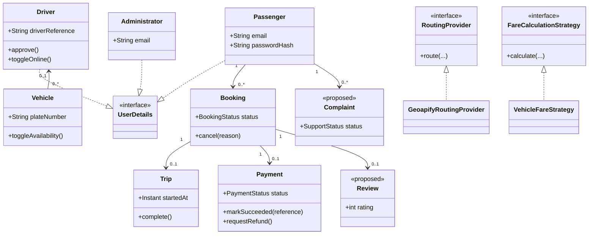

# Taxi Booking Project: Team OOP, CRUD, and Viva Guide

Use the six sections below as individual preparation notes for the six assigned team members. Replace **Person 1–6** with your team members' names and student IDs before presenting. The implementation status is based on the current code: proposed work is explicitly labeled so it is not mistaken for a working feature.

## How to use this guide

The evaluation sheet emphasizes working CRUD, OOP (encapsulation, inheritance, polymorphism, abstraction, and information hiding), database/file persistence, completeness, class diagrams, and clear individual contributions. Prepare to show the relevant Java class, service, controller, repository, and database table in the running application.

This project uses Java 17, Spring Boot, Spring Data JPA, and Flyway. Entity data is persisted through repositories; the Flyway schema is in [`V1__taxi_booking_schema.sql`](../src/main/resources/db/migration/V1__taxi_booking_schema.sql). It does not use flat-file storage for these features. Do not claim that a CRUD operation is implemented when it is only listed under **Suggested extension**.

## OOP concepts used across the project

- **Encapsulation:** entities own their fields and change their state through constructors and methods such as `Booking.cancel(...)`, `Driver.approve()`, and `Payment.markSucceeded(...)`.
- **Information hiding:** entity fields are private; callers use methods instead of directly changing internal state. Services also hide repository and database details from controllers.
- **Abstraction:** controllers call services, and services call repositories. Interfaces such as `RoutingProvider`, `FareCalculationStrategy`, and `PaymentGateway` describe behavior without requiring callers to know the implementation.
- **Inheritance / subtyping:** `Passenger`, `Driver`, and `Administrator` implement Spring Security's `UserDetails` interface. This is interface implementation (a subtype relationship), not inheritance from a shared project-defined base class.
- **Polymorphism:** a caller can use an interface and receive behavior from its implementation. For example, `FareEstimateService` calls `FareCalculationStrategy`; `VehicleFareStrategy` supplies the fare calculation. `GeoapifyRoutingProvider` implements `RoutingProvider`.
- **Composition and association:** a `Booking` belongs to a passenger and may have a trip; a vehicle may be assigned to a driver; a payment refers to its booking and passenger. These relationships are mapped by JPA.

## Person 1 — User and Passenger Management

### Responsibility and key classes

Own passenger registration, authentication-related account data, and passenger saved places. Main classes: [`Passenger`](../src/main/java/com/serendib/taxibooking/entity/Passenger.java), [`PassengerService`](../src/main/java/com/serendib/taxibooking/service/PassengerService.java), [`FavouriteLocation`](../src/main/java/com/serendib/taxibooking/entity/FavouriteLocation.java), [`FavouriteLocationService`](../src/main/java/com/serendib/taxibooking/service/FavouriteLocationService.java), and [`PassengerController`](../src/main/java/com/serendib/taxibooking/controller/PassengerController.java).

### OOP explanation

- **Encapsulation / information hiding:** `Passenger` keeps its account fields private. The service validates and normalizes registration input and encodes the password before saving it; the raw password is not stored.
- **Inheritance / subtyping:** `Passenger implements UserDetails`, allowing Spring Security to authenticate a passenger through the common `UserDetails` contract. `PassengerRole` expresses the role as an enum.
- **Abstraction:** the controller handles the web request while `PassengerService` performs registration rules and a Spring Data repository handles persistence. `FavouriteLocationService` similarly hides saved-place persistence and ownership checks.
- **Polymorphism:** Spring Security can work with different `UserDetails` implementations (passenger, driver, and administrator) through one authentication abstraction.

### CRUD and current implementation

| CRUD | Current operation | Status |
|---|---|---|
| Create | Register a passenger; add a saved HOME, WORK, or OTHER location. | Implemented |
| Read | Find a passenger for authentication and list the signed-in passenger's saved places. Admins can view passenger accounts. | Implemented |
| Update | Edit passenger profile or edit an existing saved place. | Not implemented |
| Delete | Delete an owned saved place. | Implemented; passenger-account deletion is not offered |

Saved-place operations are passenger-scoped. The service enforces at most one HOME and one WORK location per passenger. Do not represent account deletion as an available feature; there are related booking and payment records to consider.

### Viva questions and short answers

1. **Why is the password not stored as entered?** — `PassengerService` encodes it with Spring Security's `PasswordEncoder`; the database stores the hash.
2. **How do you prevent a passenger deleting someone else's saved place?** — The service looks up the location using both its ID and the authenticated passenger's ID.
3. **What does `implements UserDetails` mean?** — `Passenger` provides the contract Spring Security uses for username, password hash, authorities, and account state.
4. **Which CRUD operations are missing for passenger profiles?** — Profile update and account deletion are not currently exposed; saved places do support create, read, and delete.
5. **How is the data persisted?** — JPA repositories write the passenger and favourite-location entities to the Flyway-created database tables.

## Person 2 — Driver and Vehicle Management

### Responsibility and key classes

Own driver applications, admin review/approval, mandatory first-login password changes, driver profile administration, vehicle records, and availability. Main classes: [`Driver`](../src/main/java/com/serendib/taxibooking/entity/Driver.java), [`Vehicle`](../src/main/java/com/serendib/taxibooking/entity/Vehicle.java), [`DriverService`](../src/main/java/com/serendib/taxibooking/service/DriverService.java), [`VehicleService`](../src/main/java/com/serendib/taxibooking/service/VehicleService.java), [`DriverApplicationController`](../src/main/java/com/serendib/taxibooking/controller/DriverApplicationController.java), and [`AdminManagementController`](../src/main/java/com/serendib/taxibooking/controller/AdminManagementController.java).

### OOP explanation

- **Encapsulation / information hiding:** `Driver` protects application, approval, password-change, and online state behind methods that reject invalid state changes.
- **Inheritance / subtyping:** `Driver implements UserDetails`, so the authentication framework can handle a driver without depending on driver-specific internals.
- **Abstraction:** controllers delegate workflows to driver/vehicle services, which validate uniqueness, eligibility, and assignment rules before using repositories.
- **Polymorphism:** authentication uses the shared `UserDetails` abstraction for drivers and other account types. The vehicle's `VehicleCategory` is an enum; category-specific fare behavior is implemented separately by the fare strategy, not by subclasses of `Vehicle`.
- **Association:** a `Vehicle` has an optional `Driver`; JPA maps this relationship through `driver_id`.

### CRUD and current implementation

| CRUD | Current operation | Status |
|---|---|---|
| Create | Public driver application (with a vehicle) or admin-created driver; admin adds a vehicle. | Implemented |
| Read | Admin lists/finds drivers and vehicles; driver dashboard displays profile/vehicle details. | Implemented |
| Update | Admin edits driver details and vehicle details/assignment. | Implemented |
| Delete | Admin deletes a driver if no vehicle is assigned, and deletes a vehicle. | Implemented with driver dependency guard |

Additional state operations include application approval/rejection, temporary credential email status, mandatory password change, online/offline toggle, and vehicle availability toggle. Approval does not automatically make a driver online. Token-protected integration endpoints can receive assignment responses and trip events from an external system, but an in-app driver workflow or automatic dispatch client is not included.

### Viva questions and short answers

1. **Why can a driver not go online before approval and changing their temporary password?** — `Driver` and `DriverService` enforce those preconditions before allowing online status, and Spring Security blocks driver pages while password change is pending.
2. **How is a duplicate vehicle prevented?** — `VehicleService` checks the normalized plate number and the database also has a unique constraint.
3. **Why does driver deletion sometimes fail?** — The service prevents deleting a driver while a vehicle still references them; the vehicle must first be reassigned or removed.
4. **How is a vehicle linked to its driver?** — A JPA `ManyToOne` relationship is stored using the `driver_id` foreign key.
5. **Is an approved driver automatically assigned rides?** — No. Approval/online status exists, but automatic dispatch and driver ride acceptance are unfinished.

## Person 3 — Booking and Trip Management

### Responsibility and key classes

Own passenger booking creation, viewing, editing, cancellation, and trip lifecycle/history. Main classes: [`Booking`](../src/main/java/com/serendib/taxibooking/entity/Booking.java), [`BookingStatus`](../src/main/java/com/serendib/taxibooking/entity/BookingStatus.java), [`Trip`](../src/main/java/com/serendib/taxibooking/entity/Trip.java), [`BookingService`](../src/main/java/com/serendib/taxibooking/service/BookingService.java), [`TripService`](../src/main/java/com/serendib/taxibooking/service/TripService.java), [`BookingIntegrationService`](../src/main/java/com/serendib/taxibooking/service/BookingIntegrationService.java), [`BookingController`](../src/main/java/com/serendib/taxibooking/controller/BookingController.java), and [`TripController`](../src/main/java/com/serendib/taxibooking/controller/TripController.java).

### OOP explanation

- **Encapsulation / information hiding:** booking state transitions belong to the `Booking` entity, rather than allowing a controller to set arbitrary status values. `Trip.complete()` prevents completing an already completed trip.
- **Inheritance / subtyping:** the passenger who owns a booking is provided through the common authenticated `UserDetails` flow; `Booking` and `Trip` are associated entities, not subclasses.
- **Abstraction:** `BookingService` coordinates fare estimation, ownership, and persistence. The controller does not calculate fares or directly update database rows.
- **Polymorphism:** booking creation calls `FareEstimateService`, which uses the injected `FareCalculationStrategy` and `RoutingProvider` contracts. Different implementations can supply those behaviors without changing the booking controller.
- **Composition / association:** a booking belongs to a passenger and can have one trip; a trip references its booking.

### CRUD and current implementation

| CRUD | Current operation | Status |
|---|---|---|
| Create | Passenger creates a booking; `BookingIntegrationService.startTrip(...)` creates a trip after an allowed booking state. | Implemented |
| Read | Passenger lists and views only their bookings and trip history; admin has read-only booking overview. | Implemented |
| Update | Passenger edits a pending booking; the external integration can update trip and booking lifecycle states. | Implemented with state rules |
| Delete | Booking cancellation is a state change with a reason, not a physical database delete. | Implemented |

The passenger must own the booking for passenger operations. Only pending bookings can be edited. A trip can start only for an accepted/arriving booking and complete only when in progress. Token-protected integration endpoints support an external service's driver assignment, response, and trip lifecycle events; the app does not implement automatic driver dispatch or an in-app driver workflow. Do not demo automatic assignment as a working feature.

### Viva questions and short answers

1. **Why is cancellation not a database delete?** — The booking is retained as history and its status/reason record the cancellation.
2. **How do you stop one passenger accessing another passenger's booking?** — Service queries include both booking ID and authenticated passenger ID.
3. **What checks are made before a trip starts?** — The booking must belong to the passenger and be ACCEPTED or ARRIVING; the booking state is then advanced.
4. **Where does a booking's fare come from?** — `BookingService` asks `FareEstimateService` to calculate it from coordinates, vehicle category, and peak-hour input.
5. **What is still missing in the workflow?** — Actual driver dispatch, acceptance/rejection, and driver-side trip controls.

## Person 4 — Maps, Location, Fare, and Admin Management

### Responsibility and key classes

Own route/place/map integrations and fare estimation, plus administrator/operator workflows. Main classes: [`MapController`](../src/main/java/com/serendib/taxibooking/controller/MapController.java), [`FareController`](../src/main/java/com/serendib/taxibooking/controller/FareController.java), [`FareEstimateService`](../src/main/java/com/serendib/taxibooking/service/FareEstimateService.java), [`RoutingProvider`](../src/main/java/com/serendib/taxibooking/service/RoutingProvider.java), [`GeoapifyRoutingProvider`](../src/main/java/com/serendib/taxibooking/service/GeoapifyRoutingProvider.java), [`FareCalculationStrategy`](../src/main/java/com/serendib/taxibooking/strategy/FareCalculationStrategy.java), [`VehicleFareStrategy`](../src/main/java/com/serendib/taxibooking/strategy/VehicleFareStrategy.java), [`Administrator`](../src/main/java/com/serendib/taxibooking/entity/Administrator.java), and [`AdminOperationsService`](../src/main/java/com/serendib/taxibooking/service/AdminOperationsService.java).

### OOP explanation

- **Encapsulation / information hiding:** fare configuration, provider keys, route validation, and fare calculation are kept in configuration/services rather than exposed as database or controller logic. The map API does not expose the Geoapify key in its response.
- **Inheritance / subtyping:** `Administrator implements UserDetails`, which lets Spring Security use the same authentication contract for all account types.
- **Abstraction:** `RoutingProvider` hides the road-routing provider; `FareCalculationStrategy` hides the fare formula. Controllers request an estimate without depending on provider-specific HTTP or formula details.
- **Polymorphism:** `FareEstimateService` calls the `RoutingProvider` and `FareCalculationStrategy` interfaces. `GeoapifyRoutingProvider` and `VehicleFareStrategy` provide concrete behavior. There is one current fare strategy implementation, but the interface allows another to be substituted.
- **Composition:** fare estimation combines route data, a vehicle fare rule, and the fare strategy to return an estimate.

### CRUD and current implementation

Maps and fares are chiefly read/estimate features, not CRUD entities:

| Area | Create | Read | Update | Delete |
|---|---|---|---|---|
| Map/location | The first driver location update creates a live in-memory entry. | Place search, map configuration/tiles, and nearby-driver lookup. | Later location updates replace the driver's current in-memory entry. | Expired in-memory locations are removed by the location service. |
| Fare | `POST /api/fares/estimate` calculates a response; it does not save a fare record. | Fare configuration is read to calculate estimates. | No fare-rule admin editor is currently exposed. | No fare-rule deletion is exposed. |
| Administrator operators | Admin creates another operator. | Admin lists operators and dashboard/report data. | Operator profile editing is not exposed. | Admin can remove another operator, but not themself or the final operator. |

This combined assignment also intersects with the implemented driver and vehicle CRUD in Person 2's section. The admin panel's passenger, booking, payment, and refund pages are overviews; they are not full edit/delete interfaces. Driver location data is currently held in application memory, not persisted in the relational schema. Fare configuration is managed through application configuration, not CRUD screens.

### Viva questions and short answers

1. **What benefit does `RoutingProvider` provide?** — It decouples fare estimation from the external routing implementation and makes provider behavior replaceable/testable.
2. **How does polymorphism appear in fare calculation?** — `FareEstimateService` calls the `FareCalculationStrategy` contract; the injected `VehicleFareStrategy` supplies the actual calculation.
3. **Does a fare estimate create a database record?** — No. It returns a response; a booking later stores its estimated fare.
4. **Where are map coordinates and driver locations stored?** — Booking coordinates are persisted with bookings; current nearby-driver GPS updates are held in memory and expire.
5. **Can one administrator delete the last admin or their own account?** — No. `AdminOperationsService` prevents both cases.
6. **Where is the external map API key kept?** — In server-side configuration/environment, not in the browser response.

## Person 5 — Payment and Financial Management

### Responsibility and key classes

Own payment start/status, promotions, receipts, and refund requests. Main classes: [`Payment`](../src/main/java/com/serendib/taxibooking/entity/Payment.java), [`Promotion`](../src/main/java/com/serendib/taxibooking/entity/Promotion.java), [`Receipt`](../src/main/java/com/serendib/taxibooking/entity/Receipt.java), [`Refund`](../src/main/java/com/serendib/taxibooking/entity/Refund.java), [`PaymentService`](../src/main/java/com/serendib/taxibooking/service/PaymentService.java), [`PaymentController`](../src/main/java/com/serendib/taxibooking/controller/PaymentController.java), and [`PaymentGateway`](../src/main/java/com/serendib/taxibooking/service/PaymentGateway.java).

### OOP explanation

- **Encapsulation / information hiding:** `Payment` owns status transitions (`markSucceeded`, `markFailed`, `requestRefund`, `markRefunded`) and rejects invalid transitions. Callers cannot directly set its private fields.
- **Inheritance / subtyping:** `PaymentGateway` is an interface contract; the provider implementation can be used through that contract. Payment entities themselves do not inherit from one another.
- **Abstraction:** `PaymentService` centralizes amount, passenger ownership, promotion, and state validation. `PaymentGateway` hides provider checkout details from the payment workflow.
- **Polymorphism:** the payment service/controller uses `PaymentGateway` behavior without hard-coding the implementation. Payment methods/statuses are typed enums and the state methods enforce allowed behavior.
- **Information hiding / correctness:** amounts are based on the saved booking, monetary amounts use `BigDecimal`, and payment ownership/provider details are checked before changing state.

### CRUD and current implementation

| CRUD | Current operation | Status |
|---|---|---|
| Create | Start payment for an eligible completed booking; request a refund for a settled payment. | Implemented |
| Read | List/view owned payments, receipts, refunds, and admin payment/refund overviews. | Implemented |
| Update | Payment status changes through verified provider/cash results; a failed payment can be retried. | Implemented as validated transitions |
| Delete | Physical payment/refund deletion is not exposed. | Intentionally not implemented |

An admin refund page reviews requests; it does not claim that money was sent. Refund execution through a provider is not implemented. A passenger must own the booking/payment. Stripe success is verified before marking it settled; cash is not marked paid until collection is confirmed. Payment state changes should preserve the audit trail rather than delete financial records.

### Viva questions and short answers

1. **Why use `BigDecimal` for money?** — It avoids common binary floating-point rounding errors in financial calculations.
2. **When can a passenger pay for a booking?** — Only after the booking is completed, and the booking must belong to that passenger.
3. **What happens when a payment fails?** — Its status becomes FAILED, reserved promotion usage is released, and a retry is allowed through the service rules.
4. **How is a Stripe payment marked successful?** — A verified checkout session is checked against the payment reference, amount, currency, and provider session before the state transition.
5. **Does requesting a refund mean it has been paid back?** — No. It records a request; provider refund execution is not provided by the current application.
6. **Why not delete payment records?** — Financial records and status history need to remain auditable.

## Person 6 — Customer Support: Reviews, Ratings, and Complaints

### Responsibility and implementation status

This is the assigned support feature. **Reviews, ratings, and complaints are not implemented in the current code or database schema.** There are no support entities, repositories, services, controllers, or UI pages. The related deferred work is also mentioned in the [migration report](migration-report.md). The design and CRUD below are a proposal for a future implementation, not a description of working functionality.

Potential classes: `Review` (linked to a completed booking and its passenger; optionally linked to the driver), `Complaint` (linked to its passenger and optionally a booking), and a `SupportStatus` enum. A review should have a bounded rating (for example 1–5) and optional comment. A complaint should have a category, description, status, timestamps, and an administrator response/resolution field. Confirm required fields and retention rules with the team before implementation.

### OOP design explanation

- **Encapsulation / information hiding:** keep rating, author, booking, and complaint status private; validate rating bounds and legal status transitions in entity methods or the service.
- **Inheritance / subtyping:** use `Passenger implements UserDetails` to identify the authenticated author. Do not introduce a support base class unless multiple real entity types share behavior.
- **Abstraction:** proposed `ReviewService` and `ComplaintService` would own eligibility/ownership rules and hide repository details from controllers.
- **Polymorphism:** if more support channels are added, define a small interface (for example, `SupportNotification`) and use separate implementations. Do not add an interface solely to claim polymorphism; current support has none.
- **Association:** a review should reference a completed booking, and a complaint may reference a booking. Enforce passenger ownership server-side.

### Proposed CRUD and rules to implement

| CRUD | Proposed behavior | Current status |
|---|---|---|
| Create | Passenger submits one review/rating for an eligible completed booking, or files a complaint. | Not implemented |
| Read | Passenger views their submissions; authorized support staff/admin view and filter complaints and reviews. | Not implemented |
| Update | Passenger may edit their review/complaint under a defined policy; staff update complaint status and resolution. | Not implemented |
| Delete | Prefer a documented soft-delete/moderation or retention policy; do not silently erase the support audit trail. | Not implemented |

Before coding, agree on review eligibility, whether reviews are editable, who can moderate them, complaint status transitions, and whether deleting a review is allowed. Add a Flyway migration, JPA entities/repositories, validated DTOs, service ownership checks, role-protected routes, templates, and tests. Never trust a submitted passenger ID; use the authenticated principal.

### Viva questions and short answers

1. **Are reviews and complaints currently available in the application?** — No. This assignment is a gap and needs to be implemented before it can be demonstrated as working.
2. **How would you prevent a passenger reviewing a ride they did not take?** — Load the booking using both its ID and the authenticated passenger's ID, then require a completed status.
3. **How would you prevent duplicate reviews?** — Add a service-level eligibility check and a database unique constraint for the agreed review key (for example, one review per booking).
4. **Why use an enum for complaint status?** — It limits status values and allows explicit, validated transitions such as OPEN to IN_PROGRESS to RESOLVED.
5. **Why should a complaint not be physically deleted immediately?** — Keeping a controlled audit history supports investigation and accountability; a retention/moderation policy should govern removal.
6. **Which layers are needed?** — Entity, DTO/validation, repository, service, controller/UI, migration, authorization, and tests.

## Suggested class diagram for the presentation

This high-level diagram describes existing relationships plus the proposed support feature. Dashed classes are proposed only.

## Final individual presentation checklist

- Identify your exact assigned classes and explain the request-to-database flow.
- Demonstrate at least two working CRUD operations from your section, or clearly state the missing feature and show the proposed design if it is not implemented.
- Explain one example each of encapsulation, information hiding, abstraction, polymorphism, and inheritance/subtyping without calling interface implementation class inheritance.
- Show where validation and ownership/authorization checks happen.
- Show the Flyway table and JPA mapping that persist the data; do not claim a file-based store.
- Use a small test or a reproducible UI flow to demonstrate behavior and a rejected invalid case.
- Explain your own contribution and be ready to show your individual Git commits if available.
